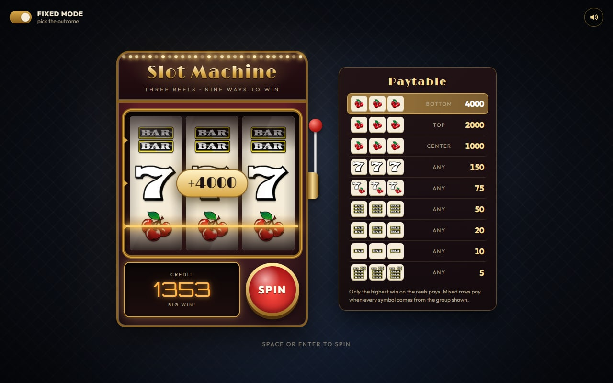

# Slot Machine

A classic three-reel slot machine written in plain JavaScript and CSS, with no framework and no build step.

**[Play it live →](https://taha-shajarian.ir/projects/slot-machin)**



## Features

- **Three animated reels** that stop one after another with a small bounce. Wins light the payline, highlight the paytable row and count the credit up.
- **Paytable with nine combinations.** Some pay only on a specific line (three cherries on the bottom line pays 4000). Others are mixed groups such as "any cherry or 7" and "any bar". When several lines win, only the highest one pays.
- **Fixed mode** (switch, top left): choose a symbol and a line, and every reel stops there. It's useful for checking each paytable rule. In fixed mode you can also double-click the credit to set it (1 to 5000).
- **Sound effects** synthesized with the Web Audio API (reel ticks, stop thunks, a win chime), so there are no audio files. The mute setting is remembered.
- **Responsive**: the cabinet and paytable sit side by side on desktop and stack on phones.
- Keyboard controls and an out-of-credit refill.

## Controls

| Action | Input |
| --- | --- |
| Spin | Click **Spin**, pull the lever, or press <kbd>Space</kbd> / <kbd>Enter</kbd> |
| Choose the outcome | Turn on **Fixed mode**, then spin |
| Edit credit (fixed mode) | Double-click the credit display |
| Close the dialog | <kbd>Esc</kbd> |

Each spin costs 1 credit, and you start with 200.

## How it works

- `constants.js` holds the symbols, the pixel offset for each symbol on each line, and the paytable.
- `script.js` has three small classes:
  - `GameManager`: game state, modes, scoring and UI feedback.
  - `Slot`: builds the reels and runs the spin and stop animation.
  - `PayTable`: renders the paytable and highlights the winning row.
- Scoring works out the three visible lines from where each reel stops, then checks the paytable from the top down, so the first (highest) match pays.

## Run locally

Open `index.html` in a browser, or serve the folder:

```sh
npx serve .
```

## License

[MIT](https://choosealicense.com/licenses/mit/)
